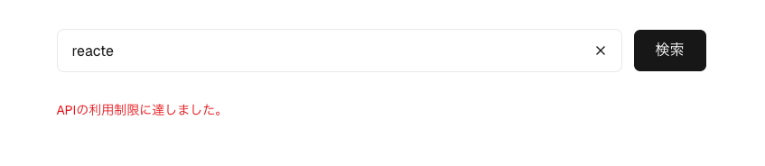
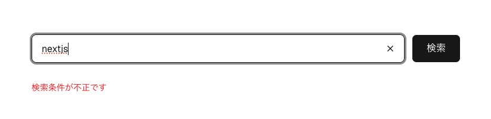
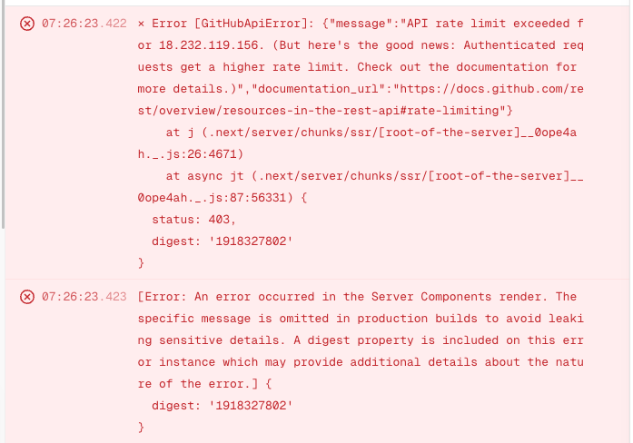

# Github Repo Search

Github リポジトリ検索アプリ

## DEMO

[https://github-repo-search-ebon-pi.vercel.app/](https://github-repo-search-ebon-pi.vercel.app/)

## Requirement (Recommended)

- Node.js (>= 22.22.3)
- pnpm (v9)

## Installation

```bash
pnpm install
```

E2Eテスト環境（Playwright）のセットアップが必要な場合は、以下のコマンドを実行してください。

```bash
npx playwright install
or
pnpm exec playwright install
```

※ GitHub API トークンは使用していないので、`.env` の設定は不要です。

## Usage

```bash
pnpm run dev
```

```bash
# 単体テスト
pnpm test

# E2Eテスト
pnpm test:e2e
```

## 開発プロセスと設計方針

### 選定

- create-next-app の Recommend (TypeScript, Tailwind CSS, ESLint, App Router, and Turbopack) を使用して雛形を作成
  - Next.js は仕様書に記載の v16 を使用
  - pnpm に変更（高速化とディスク容量に優しい）
  - button, input, pagination, spinner は shadcn/ui を使用

### コンポーネント設計

```
src/
├── app/              # Next.js 16 App Router
├── features/         # 機能ごとのコンポーネント
├── components/ui     # shadcn/uiのコンポーネント
└── lib/              # 外部ライブラリ関連（github）
```
※ テストファイルは各機能のディレクトリ直下に配置し、`e2e` は `src` ディレクトリと同階層に配置した。

- API 呼び出しは基本的に Server Component で実行
  - インクリメントサーチにしなかったのは、仕様書に「検索」ボタンが存在したことと、Github API をトークンなしで利用しているため、レートリミットを考慮する必要があるため。
  - 検索フォームにクリアボタンを追加して `/` に遷移させリセットする仕様にした（仕様書には記載なし）
- Feature Driven(コロケーション的)なフォルダ設計を採用
- 当初は `/search` に検索画面を実装したが、TOP に移行
- 詳細画面は API の `repos/:owner/:name` と同じディレクトリ構造にした
  - 仕様書の通りモーダルではなく、ページとして実装

### GithubAPI

- 検索だけなので、GitHub API トークンを使用しない設計にした。不要なオーバーエンジニアリングを避けた。
- per_page は10で固定とした。
- ページネーションは Previousと Next のみにした。実装コストとテスト工数が増えるため。
- 未定義プロパティは zod でパース時に除外

### キャッシュ

- 当初は v16 から導入された `use cache` を使ってキャッシュを試みた。
- fetch の `revalidate tag` に変更（※ 実装時に起きた問題を参照）

### エラーハンドリング

- `search/repositories` は Rate Limit 403, 422をハンドリング、それ以外は `error.tsx` に任せる設計にした。
  - 存在しないクエリは「リポジトリがありません。」を表示
  - 403 の場合は 「APIの利用制限に達しました」を表示
  - 422 の場合は 「検索条件が不正です」を表示（出ることはないはず）
- `repos/:owner/:name` は Rate Limit 403, 404 を `notFound` でハンドリング、それ以外は `error.tsx` に任せる設計にした
  - 403 の場合は 「APIの利用制限に達しました」を表示
  - 404 の場合は notFound を表示

エラー時のスクリーンショット

#### APIの利用制限に達した場合



#### 検索条件が不正の場合



### テスト

- テスティングフレームワークは vitest を使用
  - Github API クライアント(`client.ts`) を mock し、`service.ts` の API のレスポンスのテストを実装 (`lib/__tests__/service.test.ts`)
  - `SearchForm`, `RepoPagination` のコンポーネントのテストを行った。
- E2Eテストは playwright を使用。
  - TopPage, RepoDetailPage はサーバーコンポーネントなので、jsdom でテストができないため、E2Eテストとした。

### デザイン

- デザインはAI (claude code Opus 4.7) を使いました。 [getdesign.md](https://getdesign.md/) から vercel の DESIGN.md をインストールし、docs に保存し、Vercelライクな画面をAIに指示をして作成しました。

### CI

- Github Actions を使用し、lint, type-check, test を実行

### ホスティング

- Vercel を使用

## AIについて

- 使用したAI は gemini 3.1 や claude code Opus 4.7
- エディタは Antigravity を使用。
- 設計の詳細、バグの調査、Next.jsの最新動向などはAIに壁打ちをした

## 工夫した点

- 私のテストについてのポリシーは、テスティングトロフィーに則って、E2Eを少なめにし、インテグレーションテストを中心にテストすることです。Client Component は jsdom でテスト可能ですが、Server Component は jsdom でテストができないため、E2Eテストにしました。

## 課題

- E2Eテストでは実際のAPIをコールしているので、Rate Limitに達する可能性があり、Flaky なテストです。これをMSWを使ってモックすることも考えたが、今回は実装コストとの兼ね合いでGithubのAPI制限内に収まるように実装しました。

## 実装時に起きた問題

- サーバーコンポーネントで API をコールする際のキャッシュ戦略として、勉強を兼ねて v16 から導入された `use cache` を使った実装を試みた。

- Rate Limit 制限のエラーを再現し、ローカルでは 403 エラーとしてエラー文言が表示されていたが、プロダクション環境では Server Component レンダリングでのエラーが発生し 500 エラーの画面が表示されていた。ローカルでは再現せず、ログを調査して原因を特定するのに苦労した。



- **`use cache` 関数内で throw された例外は、呼び出し元の try/catch には届かず、Server Component のレンダリングエラーになる。**
- `use cache` ディレクティブを付けた関数内で例外を throw すると、その例外は呼び出し元の try/catch ブロックに到達せず、Server Components のレンダリングエラーとして直接エラーバウンダリ（`error.tsx`）に到達する。
- fetch の `revalidate tags` を使うキャッシュ方法に変更し問題を解決した。
