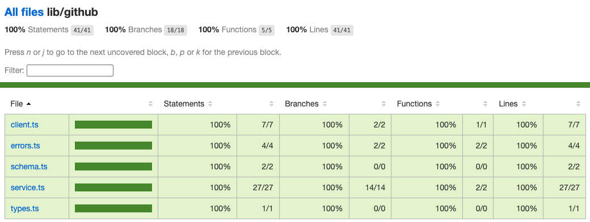
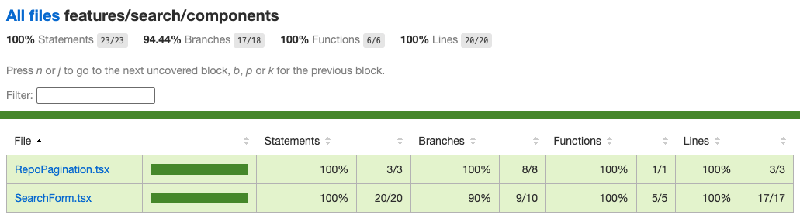
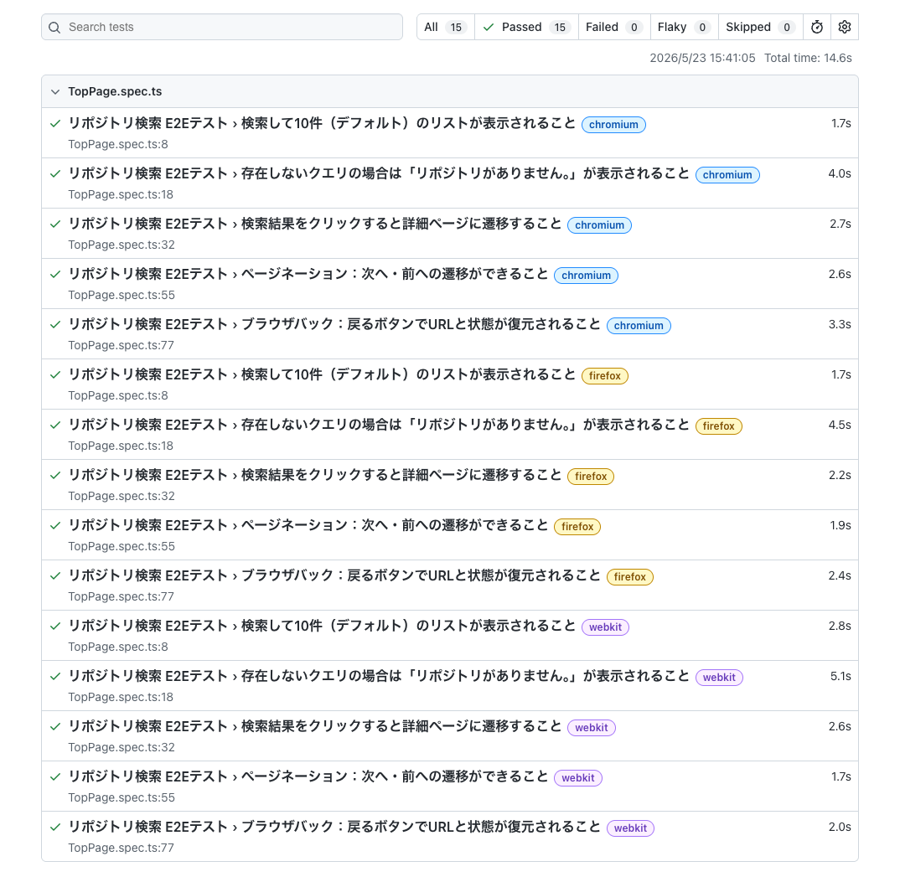

# Github Repo Search

GitHub リポジトリ検索アプリ

## DEMO

[https://github-repo-search-ebon-pi.vercel.app/](https://github-repo-search-ebon-pi.vercel.app/)

## Requirement (Recommended)

- Node.js (>= 22.22.3)
- pnpm (v9)

## Installation

```bash
pnpm install
```

E2Eテスト環境（Playwright）のセットアップが必要な場合は、以下のコマンドを実行してください。

```bash
npx playwright install
or
pnpm exec playwright install
```

※ GitHub API トークンは使用していないので、`.env` の設定は不要です。

## Usage

```bash
pnpm run dev
```

```bash
# 単体テスト
pnpm test

# E2Eテスト
pnpm test:e2e
```

## 開発プロセスと設計方針

### 選定

- create-next-app の Recommend (TypeScript, Tailwind CSS, ESLint, App Router, and Turbopack) を使用して雛形を作成
  - Next.js は仕様書に記載の v16 を使用
  - pnpm に変更
  - button, input, pagination, spinner は shadcn/ui を使用

### コンポーネント設計

```
src/
├── app/              # Next.js 16 App Router
├── features/         # 機能ごとのコンポーネント
├── components/ui     # shadcn/uiのコンポーネント
└── lib/              # 外部ライブラリ関連（github）
```

※ テストファイルは各機能のディレクトリ直下に配置し、`e2e` は `src` ディレクトリと同階層に配置した。

- API 呼び出しは基本的に Server Component で実行
  - インクリメントサーチにしなかったのは、仕様書に「検索」ボタンが存在したことと、GitHub API をトークンなしで利用していて、レートリミットを考慮する必要があるため。
  - 検索フォームにクリアボタンを追加して `/` に遷移させリセットする仕様にした（仕様書には記載なし）
- Feature Driven(コロケーション的)なフォルダ設計を採用
- 当初は `/search` に検索画面を実装したが、TOP に移行
- 詳細画面は API の `repos/:owner/:name` と同じディレクトリ構造にした
  - 仕様書の通りモーダルではなくページとして実装

### GitHub API

- 公開検索のみの用途であるため、GitHub API トークンを使用しない設計にした。不要なオーバーエンジニアリングを避けた。
- per_page は開発効率を鑑みてデフォルト10件とした。
- ページネーションのUIは今回は実装コストとテスト工数のバランスを考慮し `Previous`, `Next` のみにした。（※ 実プロダクトであればページ数も表示すべき。）
- zod でパース時に不要なフィールドは除外

### キャッシュ

- 開発当初は v16 から導入された `use cache` を使ってキャッシュを試みた。
- fetch の `revalidate`, `tag` に変更（[※ 実装時に起きた問題を参照](#実装時に起きた問題)）

### エラーハンドリング

- `search/repositories` は Rate Limit 403, 422をハンドリング、それ以外は `error.tsx` に任せる設計にした。
  - 存在しないクエリは `リポジトリがありません。` を表示
  - 403 の場合は `APIの利用制限に達しました` を表示
  - 422 の場合は `検索条件が不正です` を表示（`/?q=react&page=101` 実行で出る）
- `repos/:owner/:name` は Rate Limit 403 をハンドリング、404 は `notFound`、それ以外は `error.tsx` に任せる設計にした
  - 403 の場合は `APIの利用制限に達しました` を表示
  - 404 の場合は notFound を表示

### エラー時のスクリーンショット

#### APIの利用制限に達した場合


#### 検索条件が不正の場合 （※意図的に表示）


### テスト

- テスティングフレームワークは vitest を使用
  - GitHub API クライアント `client.ts` を mock し、`service.ts` の API のレスポンスのテストを実装した。
  - 実を言うと、`client.ts` をモックしてテストしていたが、AIにレビューしてもらい、`fetch` をモックするべきとアドバイスを受けて修正した。

##### lib/github のカバレッジ100％



- `SearchForm`, `RepoPagination` のコンポーネントのテスト

##### features/search/components のカバレッジ100%



- E2Eテストは playwright を使用。
  - TopPage, RepoDetailPage はサーバーコンポーネントなので、jsdom でテストができないため、E2Eテストとした。

##### e2e report



### デザイン

- デザインはAI (claude code Opus 4.7) を使いました。 [getdesign.md](https://getdesign.md/) から vercel の DESIGN.md をインストールし、docs に保存し、Vercelライクな画面をAIに指示をして作成しました。
- レスポンシブ対応もAIに任せましたが、デザインに従ったレスポンシブ対応をAIが実装してくれた形です。

### Lighthouse


パフォーマンス： LCP 1.8s / FCP 1.1s / CLS 0

### CI

- GitHub Actions を使用し、format:check, lint, type-check, test:ci, e2e を実行

### ホスティング

- Vercel を使用

## AIについて

### 使用ツール

- Claude Code (Opus 4.7)
- Antigravity IDE (Gemini 3.5)

### AI を使った範囲

- デザイン実装（Vercel DESIGN.md を参照させた）
- Next.js v16 の最新動向の確認
- PRの概要をまとめる
- バグ調査の壁打ち
- 設計の壁打ち
- 最後のレビュー

### AI に任せなかった範囲

- アーキテクチャ設計(コンポーネント構成、ディレクトリ設計)
- キャッシュ戦略の判断
- テスト戦略の設計
- エラーハンドリングの方針

## 工夫した点

- 私のテストについてのポリシーは、テスティングトロフィーに則ってE2Eを少なめにし、インテグレーションテストを中心にテストすることです。Client Component は jsdom でテスト可能ですが、Server Component は jsdom でテストができないため、E2Eテストにした。
- Server Component を Container/Presentational パターンにして純粋な関数としてのコンポーネントをテストすることも可能だが、そこまで複雑なロジックがないコンポーネントをテストする価値は高くないと判断した。

## 課題

- E2Eテストでは、本番と同等の環境でのテストを想定し、実際のAPIをコールしているので、Rate Limitに達する可能性があります。今回は制限内に収まる程度のテストなので問題なかったが、Flaky なテストなので、実プロダクトでは、CI 用に GitHub Personal Access Token を発行して Rate Limit を上げる対応が現実的。

## 実装時に起きた問題

### 本番環境で、Rate Limit のエラーが 500エラーで表示される

- サーバーコンポーネントで API をコールする際のキャッシュ戦略として、勉強を兼ねて v16 から導入された `use cache` を使った実装を試みた。
- ローカルで、Rate Limit 制限のエラーを再現し、403 エラーとしてエラー文言が表示されるのを確認していた。しかし、プロダクション環境では Server Component の レンダリングエラー が発生し 500 エラーの画面が表示されていた。ローカルでは再現せず、Vercel のダッシュボードのログを調査して原因を特定するのに苦労した。


- 原因は`use cache` ディレクティブをつけた関数内で例外を throw すると、その例外は呼び出し元の try/catch ブロックに到達せず、Server Components のレンダリングエラーとして直接エラーバウンダリ（`error.tsx`）に到達してしまう（`use cache` がキャッシュ境界を作っており、throw した Error クラスがシリアライズされて `instanceof GitHubApiError` が false になり、上位の `service.ts` の catch をすり抜けたこと。ローカル (`next dev`) ではキャッシュが in-memory のためシリアライズが発生せず再現しなかった。）
- fetch の `next: { revalidate, tags }` を使うキャッシュ方法に変更し問題を解決した。
